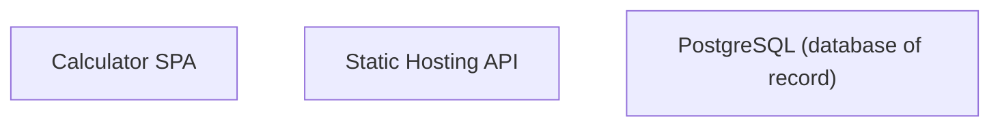
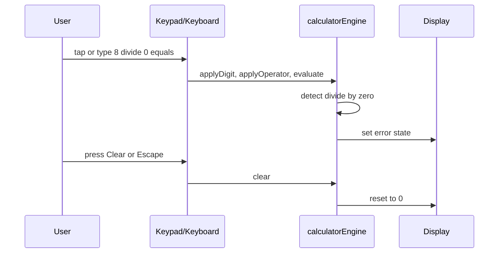
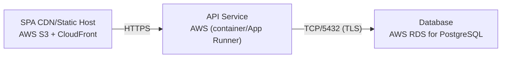

# Architecture

> Maintained by QuorQ AI SDLC. Text between `sdlc:auto` markers is regenerated; anything outside them is yours and is kept.

<!-- sdlc:auto:start narrative -->
## Overview

### ARCH-OVERVIEW · approved · source: architecture:summary

Overall architecture is a stateless, anonymous, client-only calculator SPA with a minimal backend present only to host the build.

Decided (v1, approved): deliver a four-function-plus-percentage calculator as a responsive React 19 single-page app running entirely in the browser. All arithmetic, decimal entry, percentage, clear/reset, divide-by-zero error handling and negative-result formatting happen client-side with no network calls, accounts, or persistence. FastAPI 0.115 exists only to serve the built static page and host a future home for optional analytics. PostgreSQL 16 is named the database of record but is empty by design. Hosting is on AWS behind a CDN for cheap, spike-absorbing delivery without server management. The SPA and API are served from two separate origins per platform convention; no sign-in, sessions, or tokens are needed because the app is anonymous and stateless.

### ARCH-COMP-FRONTEND · approved · source: architecture:component:frontend

The Calculator SPA (React 19) is the entire product: a responsive single page performing all calculator operations client-side.

Component: frontend - Calculator SPA (React 19). Provides an on-screen keypad and a physical-keyboard listener that perform add, subtract, multiply, divide, percentage, decimal entry, clear/reset, division-by-zero error state, and negative-result display -- all in browser state with no persistence.

### ARCH-COMP-API · approved · source: architecture:component:api

The Static Hosting API (FastAPI 0.115) serves the built SPA and a health endpoint; it holds no calculator logic.

Component: api - Static Hosting API (FastAPI 0.115). Serves the built SPA assets and exposes a health endpoint. Stores nothing and contains no calculator logic; present as a lightweight place to add optional server features later, e.g. anonymous usage counts.

### ARCH-COMP-DB · approved · source: architecture:component:db

PostgreSQL 16 is the named database of record but remains empty by design since the product is stateless.

Component: db - PostgreSQL (database of record), PostgreSQL 16. Named default datastore. Sits empty by design because the product is stateless and keeps no history; provisioned only so future optional features have a place to store data.

### ARCH-CRITICALPATH-001 · approved · source: architecture:critical_path:In-browser calculation and display

The sole critical path is fully client-side: user input via keypad or keyboard flows straight into in-browser calculation and display.

User enters operands and an operator via on-screen keypad or physical keyboard, presses equals/Enter, and the calculator engine computes the result purely in browser state. Formatting rules: negatives are shown with a minus sign, a single decimal point is enforced during entry, and the display switches to an error state on divide-by-zero. Clear/Escape resets state to 0.

**Related:** ARCH-COMP-FRONTEND

### ARCH-ENDPOINTS · approved · source: architecture:endpoints

The API exposes exactly two endpoints: serving the SPA and a health probe.

GET / - Serves the built React SPA (index and static assets) that contains the entire calculator. GET /health - Liveness/readiness probe for the hosting layer. No calculator or data endpoints exist, consistent with the client-only design.

**Related:** ARCH-COMP-API

### ARCH-DEPLOY · approved · source: architecture:deployment_nodes

Three deployment nodes on AWS: a CDN-fronted static host for the SPA, a containerized API service, and an RDS database.

SPA CDN/Static Host: AWS S3 + CloudFront serving the static React 19 build. API Service: AWS container/App Runner running FastAPI 0.115 on Python 3.12 via Uvicorn. Database: AWS RDS for PostgreSQL, PostgreSQL 16. The SPA and API are intentionally served from two separate origins per platform convention.

**Related:** ARCH-COMP-FRONTEND, ARCH-COMP-API, ARCH-COMP-DB

### ARCH-TECH-FRONTEND · approved · source: architecture:technology_decision:Frontend

Frontend technology chosen: React 19, over Vue 3, Svelte, and Vanilla JS.

Decision: React 19. Rationale given: it renders the whole product in the browser -- the display, a responsive button grid that reflows between phone and desktop, a keyboard listener, and the calculation state including the division-by-zero error state and negative results. Alternatives considered: Vue 3, Svelte, Vanilla JS.

### ARCH-TECH-BACKEND · approved · source: architecture:technology_decision:Backend

Backend technology chosen: FastAPI 0.115, over Flask, Node/Express, and a static-only (no backend) option.

Decision: FastAPI 0.115. Rationale given: it is the lightest approved way to host the built page and expose a health check, leaving a place to add optional server features such as anonymous usage counts later. Alternatives considered: Flask, Node/Express, Static-only (no backend).

### ARCH-TECH-DB · approved · source: architecture:technology_decision:Database

Database technology chosen: PostgreSQL 16, over no database or SQLite, despite currently storing nothing.

Decision: PostgreSQL 16, named as the default database of record even though the stateless, history-free design (referenced as NFR-004 in the architecture input) means it stores nothing today. Alternatives considered: No database, SQLite.

**Related:** NFR-004

### ARCH-TECH-CLOUD · approved · source: architecture:technology_decision:Cloud

Cloud platform chosen: AWS, over Vercel, Netlify, and GCP.

Decision: AWS. Rationale given: AWS serves the static-feeling single page inexpensively via S3+CloudFront and absorbs large, unexpected traffic spikes without server management (referenced as NFR-005 in the architecture input). Alternatives considered: Vercel, Netlify, GCP.

**Related:** NFR-005
<!-- sdlc:auto:end narrative -->

<!-- sdlc:auto:start building-blocks -->
## Building Block View

| ID | Name | Technology | Responsibility | Depends on |
|---|---|---|---|---|
| frontend | Calculator SPA | React 19 | The entire product: a responsive single page with an on-screen keypad and physical-keyboard listener that performs add/subtract/multiply/divide, percentage, decimal entry, clear/reset, division-by-zero error state and negative results, all in the browser with no persistence. | — |
| api | Static Hosting API | FastAPI 0.115 | Serves the built SPA assets and exposes a health endpoint. Holds no calculator logic and stores nothing; present as a lightweight place to add optional server features (e.g. anonymous usage counts) later. | — |
| db | PostgreSQL (database of record) | PostgreSQL 16 | Named default datastore. Sits empty by design because the product is stateless and keeps no history; provisioned only so future optional features have a place to store data. | — |

<!-- sdlc:auto:end building-blocks -->

<!-- sdlc:auto:start runtime -->
## Runtime View

### In-browser calculation and display

User enters operands and an operator via on-screen keypad or physical keyboard, presses equals/Enter, and the calculator engine computes the result purely in browser state, formatting negatives with a minus sign, enforcing a single decimal point, and switching to an error state on divide-by-zero. Clear/Escape resets state to 0.

- **Components:** frontend
- **Modules:** calculatorEngine, Keypad, Display, useKeyboardInput
- **Key functions:** applyDigit(state, digit), applyDecimalPoint(state), applyOperator(state, op), applyPercent(state), evaluate(state), clear(state), formatDisplay(value)

<!-- sdlc:auto:end runtime -->

<!-- sdlc:auto:start deployment-view -->
## Deployment View

| Name | Service | Runtime | Scaling | Environment |
|---|---|---|---|---|
| SPA CDN/Static Host | AWS S3 + CloudFront | Static React 19 build | CDN edge caching, scales to large spikes automatically | dev |
| API Service | AWS (container/App Runner) | FastAPI 0.115 on Python 3.12 (Uvicorn) | Scale-to-low, auto-scale on request count | dev |
| Database | AWS RDS for PostgreSQL | PostgreSQL 16 | Single small instance; idle by design | dev |

| Source | Target | Protocol |
|---|---|---|
| SPA CDN/Static Host | API Service | HTTPS |
| API Service | Database | TCP/5432 (TLS) |

<!-- sdlc:auto:end deployment-view -->

<!-- sdlc:auto:start decisions -->
## Architecture Decisions

| Layer | Choice | ADR |
|---|---|---|
| Frontend | React 19 | [ADR-0001](adr/frontend.md) |
| Backend | FastAPI 0.115 | [ADR-0002](adr/backend.md) |
| Database | PostgreSQL 16 | [ADR-0003](adr/database.md) |
| Cloud | AWS | [ADR-0004](adr/cloud.md) |
<!-- sdlc:auto:end decisions -->

<!-- sdlc:auto:start links -->
## Related Documents

- [Data Model](data-model.md)
- [API Specification](api/openapi.yaml)
- [Architecture Decision Records](adr/README.md)
<!-- sdlc:auto:end links -->
